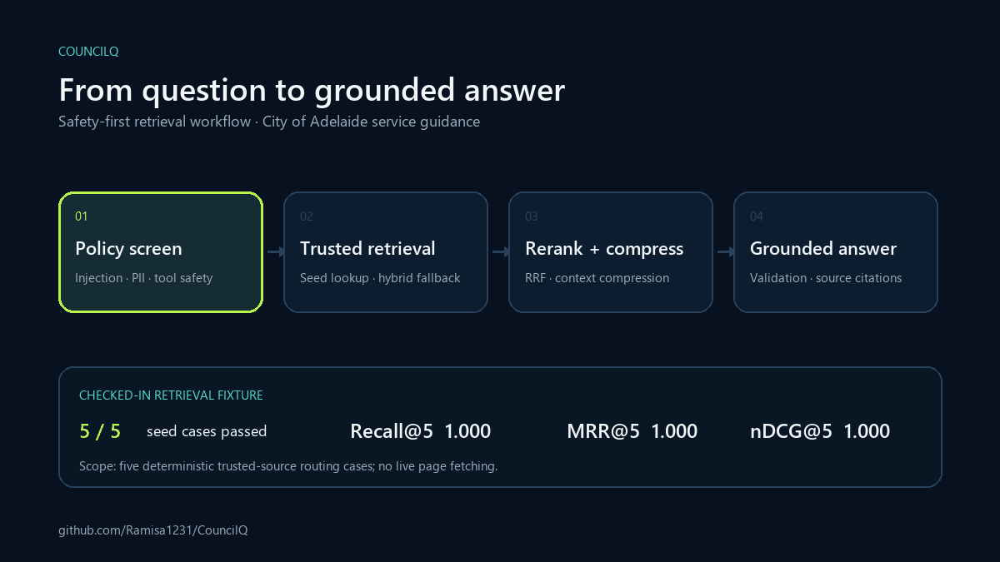

<div align="center">

# Syeda Ramisa Fariha — Applied AI Portfolio

**Applied AI Engineer building evaluated, safety-aware AI systems**

[View live portfolio](https://ramisa1231.github.io/ramisa-portfolio/) · [GitHub profile](https://github.com/Ramisa1231) · [LinkedIn](https://www.linkedin.com/in/syedaramisafariha)

</div>

---

## About this portfolio

This site presents my work across retrieval-augmented generation, AI agents, machine learning, full-stack development, research, and responsible technical delivery.

The portfolio is designed around evidence rather than technology lists: each project is labelled by context and highlights the problem, engineering approach, and evaluation strategy.



## Featured case study: CouncilQ

[CouncilQ](https://github.com/Ramisa1231/CouncilQ) is a read-only policy assistant for City of Adelaide service questions.

The system combines:

- Central prompt-injection, PII, and unsafe-tool policy checks
- Trusted-source lookup and offline council-document ingestion
- Dense and lexical retrieval with reciprocal-rank fusion
- Reranking and extractive context compression
- Grounding validation and source citations
- Deterministic tests and retrieval benchmarks using Recall, MRR, and nDCG

### Reproducible retrieval result

The checked-in retrieval fixture currently passes **5/5 deterministic trusted-source routing cases** at `k=5`, with **Recall@5 1.000**, **MRR@5 1.000**, and **nDCG@5 1.000**. The benchmark runs with live page fetching disabled and validates the curated seed-routing fixture; it is not presented as a production-corpus result.

## Selected engineering evidence

| Project | Context | Engineering evidence |
| --- | --- | --- |
| [CouncilQ](https://github.com/Ramisa1231/CouncilQ) | Independent applied-AI system | 5/5 checked-in seed-routing cases passed; Recall@5, MRR@5, and nDCG@5 each 1.000, with hybrid retrieval, grounding, and policy controls |
| [Emotion-Based Music Recommender](https://github.com/Ramisa1231/Emotion-Based-Music-Recommender) | Independent ML application | Emotion Match, Diversity, Novelty, Correction Factor, and Listener Satisfaction evaluation |
| [LLM-Guided TCP Protocol Fuzzing](https://github.com/Ramisa1231/LLM-Guided-Protocol-Fuzzing-for-TCP-Handshake-Packets) | Research project | Grammar inference, packet validity, hallucination, relative-position, and state-transition evaluation |
| [Agentic Coach](https://github.com/Ramisa1231/Agentic_Coach) | Competition prototype | Deterministic multi-module workflow with pytest coverage and documented architecture |

## Volunteer case study: Saroni Roy Foundation

The [SRF section](https://ramisa1231.github.io/ramisa-portfolio/#srf) documents my volunteer web development on Super Naari:

- **Development:** React, TypeScript and Tailwind CSS navigation fixes in [merged PR #32](https://github.com/Aria622/Saroni-Roy-Foundation/pull/32), including mobile-menu behaviour and the tablet breakpoint.
- **Verification:** Eight viewport widths, cross-route navigation, browser history, intended 404 responses, targeted ESLint validation and a passing production build.
- **Troubleshooting:** Wix contact-form CMS and automation checks identified a missing internal recipient and an inactive visitor-confirmation workflow.
- **Outcome boundaries:** GitHub changes were merged. Wix work was checked in staged previews; email configuration remained pending and the official Wix site was unpublished in the September 2026 record.

The case study summarises the supplied July and September contribution records without publishing support conversations, account details, test submissions or internal configuration identifiers.

## Practical AI delivery

I turn ambiguous technical problems into systems that can be evaluated and maintained. My approach is to clarify the problem, define trusted evidence and safety boundaries, prototype the smallest useful workflow, and document measurable acceptance criteria.

## Design and engineering

- Semantic, accessible HTML
- Responsive layout for desktop and mobile
- Keyboard focus states and skip navigation
- Open Graph and search metadata
- Honest project provenance and contribution framing
- Lightweight static implementation with no framework or build step
- Automated GitHub Pages deployment

## Technology

| Area | Technologies |
| --- | --- |
| Core AI / ML | RAG, AI agents, embeddings, NLP, evaluation |
| Backend & APIs | Python, FastAPI, Flask, Django |
| Frontend | HTML, CSS, JavaScript, React, TypeScript, Tailwind CSS |
| Cloud & delivery | Google Cloud, Docker, GitHub, GitHub Pages, stakeholder discovery |

## Run locally

```bash
git clone https://github.com/Ramisa1231/ramisa-portfolio.git
cd ramisa-portfolio
python -m http.server 8000
```

Open [http://localhost:8000](http://localhost:8000).

## Deployment

Every push to `main` deploys automatically through GitHub Pages branch deployment.

Live site: **[ramisa1231.github.io/ramisa-portfolio](https://ramisa1231.github.io/ramisa-portfolio/)**

## Contact

I am interested in applied AI, responsible AI, machine learning, and software roles where technical judgement and collaboration matter.

- [LinkedIn](https://www.linkedin.com/in/syedaramisafariha)
- [GitHub](https://github.com/Ramisa1231)
